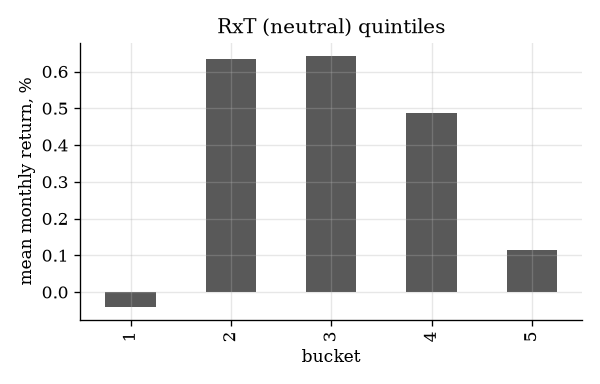
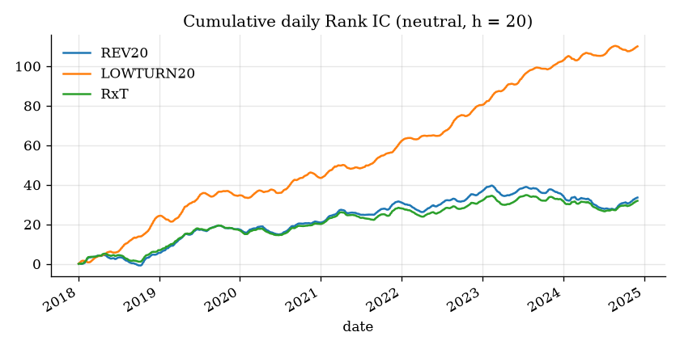

# CSI 500 Reversal x Turnover Factor Study

**Question.** Does the 20-day price reversal, combined with turnover, predict the returns of CSI 500 stocks after A-share trading rules and costs?

This project answers the question with a pre-registered test on the CSI 500 index of China A-shares.
The plan, the tests, and the pass criteria were fixed and approved before the first result.
All data is public.

## Provenance

This project is an independent reproduction with public data.
During a quantitative research internship in 2025, the author worked on this research direction.
This project does not use data, code, or results from that internship.
All data comes from public sources: BaoStock and AKShare.
The factor definitions, the sample, and the results are different from the internal version.
The numbers in this project do not confirm or replace the internal results.
The author made this project in October 2026, after the internship.

## Result

**The pre-registered factor did not pass the development test.**
Its daily Rank IC was positive but small, and its quintile portfolios were not monotonic.
Out of sample, it met the weaker sign rule in both holdout periods, but the results were not stable.
The confirmatory test of low turnover failed in 2025.

| Test | Period | Mean Rank IC (20 days) | HAC t | Top quintile minus CSI 500 total return, after 20 bps | Verdict |
|---|---|---|---|---|---|
| Primary `RxT`, development | 2018-01 to 2024-12 | 0.019 | 2.23 | -6.8% a year (IR -0.97) | **Fail** (3 of 5 criteria not met) |
| Primary `RxT`, holdout A | 2025 | 0.051 | 3.16 | +0.4% a year (IR 0.10); -3.0% after 40 bps | Pass (sign rule only) |
| Primary `RxT`, holdout B | 2026-01 to 2026-09 | 0.021 | 0.63 | +21.0% a year (IR 1.43, 9 months) | Pass (sign rule only) |
| Confirmatory `LOWTURN20`, holdout A | 2025 | 0.025 | 0.82 | -7.0% a year (IR -1.26) | **Fail** |
| Confirmatory `LOWTURN20`, holdout B | 2026-01 to 2026-09 | 0.038 | 1.39 | +0.3% a year (IR 0.09) | Pass (sign rule only) |

The sign rule asks only for a positive IC and a positive hedged return after 20 bps.
The rule is weak by design, because one holdout year gives approximately 12 independent monthly observations.
The low-turnover test was added after the development result and before the holdouts were opened.

Terms used in this README:

- **Rank IC** (information coefficient) is the daily rank correlation between the factor and the next 20-day return.
- **ICIR** is the mean IC divided by its standard deviation.
- **HAC t** is a t-statistic that corrects for the overlap of 20-day returns (Newey-West method).
- **IR** (information ratio) is the annualized mean of the hedged return divided by its volatility.
- **Neutralized** means that the industry effect and the size effect are removed from the factor each day.

Four findings:

1. Turnover is the strong part. Low turnover alone had a development IC of 0.066 (t 6.7) and monotonic quintiles. The reversal part added little. The product of the two put high-turnover stocks in both tails, and those stocks did badly.
2. The interaction did not help in any period. The combined factor never had a higher IC than the plain reversal.
3. Costs decide the result. The factor trades about 150% of the portfolio each month (buys plus sells). At 20 bps for each trade, that costs about 3.3% a year.
4. Hedges cost money. A short position in CSI 500 index futures (IC) cost 7.1% a year from 2019-04 to 2024-12, and 13.3% in 2025, because the futures traded below the index.

## The five factor-research questions

| Question | Answer |
|---|---|
| Instruments | CSI 500 constituents, by the index member list on each date (weekly snapshots). ST stocks, suspended stocks, and stocks listed for less than 60 days are removed. Stocks that open at a price limit on the trade day are removed. |
| Data frequency | Daily bars. The signal is calculated each day after the close. The portfolios trade once a month, at the next open. |
| Sample length | Development 2018-01-02 to 2024-12-31 (7 years, 83 rebalances). Holdout A 2025 (11 rebalances). Holdout B 2026-01-05 to 2026-09-30 (9 rebalances). Each holdout was opened once, after a code freeze. |
| Factors | 5 factors, each raw and neutralized, at 1, 5, and 20 days: 30 tests. Types: price reversal, turnover level, and three combinations (product, rank product, and sum). Results are in the next table. |
| Pass criterion | Fixed before the first result. Development: mean IC >= 0.02; HAC t >= 2 and Benjamini-Hochberg q <= 0.05; positive IC in at least 5 of 7 years; monotonic quintiles; and a hedged top quintile with IR >= 0.5 after 20 bps that also makes money after 40 bps. Holdouts: positive IC and a positive hedged return after 20 bps. |

## Factor results (development, neutralized, 20 days)

| Factor | Type | Mean IC | ICIR | HAC t | Quintile monotonicity | Long-short after 20 bps | Top quintile minus CSI 500 total return | Monthly turnover |
|---|---|---|---|---|---|---|---|---|
| `REV20` | Reversal | 0.020 | 0.19 | 2.08 | 0.3 | -7.5% a year | -5.0% (IR -0.75) | 155% |
| `LOWTURN20` | Low turnover | **0.066** | **0.64** | **6.69** | **1.0** | **+4.8%** (Sharpe 0.47) | **+2.5%** (IR 0.45) | 66% |
| `RxT` (primary) | Reversal x turnover | 0.019 | 0.20 | 2.23 | 0.1 | -6.3% | -6.8% (IR -0.97) | 146% |
| `RxT_RANK` | Rank product | 0.019 | 0.20 | 2.23 | 0.3 | -7.6% | -6.4% (IR -0.88) | 145% |
| `ADD` | Sum of the two parts | 0.055 | 0.55 | 5.24 | 0.9 | -1.7% | -0.8% (IR -0.11) | 128% |

All 30 development tests had a Benjamini-Hochberg q below 0.05.
Holdout A had 19 of 30 and holdout B had 1 of 30.
Low turnover was not the primary factor. It was registered as a separate confirmatory test after the development result and before the holdouts were opened. It failed in 2025 (top quintile -7.0% a year) and passed narrowly in 2026 (+0.3%).

The full tables are in [`docs/EXPERIMENT_LOG.md`](docs/EXPERIMENT_LOG.md), entries E5, E8, and E9.



The primary factor's quintiles have an inverted U shape. Both outer quintiles hold high-turnover stocks.



The low-turnover IC increases steadily. The reversal and product ICs stop increasing after 2022.

## Why this study is reliable

- The plan, the tests, and the pass criteria were written before any return was calculated. Each later change has a dated entry in the log.
- The universe uses the index members on each date. It includes stocks that left the index or delisted later.
- The signal uses data up to the close of day t. The trade occurs at the open of day t+1. Tests change all data after a date and make sure that no earlier value changes.
- The model blocks a buy when a stock opens at the upper price limit or is suspended. It blocks a sell when a stock opens at the lower limit or is suspended.
- A freeze file records the hash of the configuration and of the source code. The holdout runs do not start if either one changed.
- A separate code review (also AI-assisted) before the first run found six defects. They were corrected before any result existed (log entry E2).

## Pipeline

```
BaoStock + AKShare -> raw Parquet (unchanged) -> panel (dates x stocks) -> signals -> labels
   -> Rank IC family (30 tests) -> quintiles and long-short -> long-only top quintile with hedge
   -> pass or fail -> runs/<split>-<time>/summary.json
```

[`docs/METHODOLOGY.md`](docs/METHODOLOGY.md) shows where each step is in the code.

## Data

All data is public. The project does not use an account, a key, or paid data.

| Data | Source | Use |
|---|---|---|
| Daily bars, not adjusted | BaoStock | Prices, turnover, trading status, ST flag |
| CSI 500 members, weekly | BaoStock | Universe on each date |
| Listing dates, trading calendar | BaoStock | Filters and dates |
| Industry history | Shenwan, through AKShare | Industry neutralization |
| CSI 500 total return and price index | CSIndex, through AKShare | Hedges |
| IC index futures, per contract | Sina, through AKShare | Futures hedge, from 2019-04 |

**Turnover** is the daily volume divided by the tradable A-share count, in percent.
**ST** is the exchange flag for a company with financial problems.
The data has 1.32 million stock-day rows for 1,216 stocks.
[`docs/DATA_PROFILE.md`](docs/DATA_PROFILE.md) gives the data size, the data problems, and the unusual distributions.

## Reproduce the results

### Prerequisites

- Python 3.11 or later.
- [uv](https://docs.astral.sh/uv/), the Python package manager.
- Internet access for the first download. The download takes approximately 2.5 hours.

### Procedure

1. Install the packages, including the data adapters:

   ```sh
   uv sync --all-extras
   ```

2. Download the raw data to `data/raw/`:

   ```sh
   uv run revturn download
   ```

3. Build the panel in `data/processed/`:

   ```sh
   uv run revturn build
   ```

4. Run the development split:

   ```sh
   uv run revturn run --split dev
   ```

5. Compare a new run with an earlier run:

   ```sh
   uv run revturn reproduce --run runs/<run-id>
   ```

The command in step 5 runs the split again. It compares each number in `summary.json` and shows the differences.
The development run of record reproduced 1,243 of 1,243 numbers.

A holdout run (`--split oos_a` or `--split oos_b`) needs `configs/freeze.json`.
That file records the hash of the configuration and of the source code. If either one changes, the holdout run stops.

### Tests

The tests use synthetic data. They do not use the network.

```sh
uv run pytest -q
uv run ruff check .
```

The tests include look-ahead guards. These tests change all data after a date. Then they make sure that no signal, filter, label, or portfolio value on or before that date changes.

## Limitations

- BaoStock gives a weekly copy of the index members. It is not the official CSIndex history. Three rebalances appear late: by 5 weeks in June 2021 and December 2021, and by 14 weeks in December 2022. A robustness check removes these periods; the development IC changes from 0.019 to 0.021.
- The size factor uses the tradable market value from turnover. It is not the free-float value that CSIndex uses.
- The data has daily bars only. The model fills each trade at the open price. It does not model auction depth or market impact.
- The long-short result is a diagnostic. Short sales of single A-shares are limited in practice.
- The industry history can contain later corrections. This can cause a small look-ahead error in the neutralized factors.
- Holdout B has 9 months only, in a falling market. Its large hedged return is not evidence of a stable effect.

## Documents

| Document | Content |
|---|---|
| [`docs/RESEARCH_PROTOCOL.md`](docs/RESEARCH_PROTOCOL.md) | The plan, fixed before the first result |
| [`docs/METHODOLOGY.md`](docs/METHODOLOGY.md) | How the code applies the plan |
| [`docs/DATA_PROFILE.md`](docs/DATA_PROFILE.md) | Data size, problems, and distributions |
| [`docs/EXPERIMENT_LOG.md`](docs/EXPERIMENT_LOG.md) | Each run and each change, in date order |
| [`docs/LOCAL_SETUP.md`](docs/LOCAL_SETUP.md) | Notes for a Mac with iCloud Drive |

## Notes

This project is research. It is not investment advice.
The author approved the research plan before the first result and made the decisions at each gate.
An AI coding assistant drafted the plan, wrote the code and the documents, and ran the study.

## Licence

MIT. See [`LICENSE`](LICENSE).
The licence covers the code and the documents. It does not cover data from BaoStock or AKShare.
The repository does not include that data. The `revturn download` command gets it from the sources.
